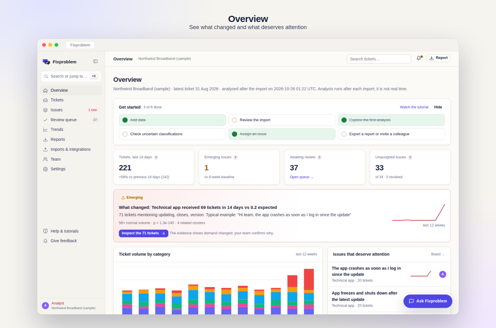
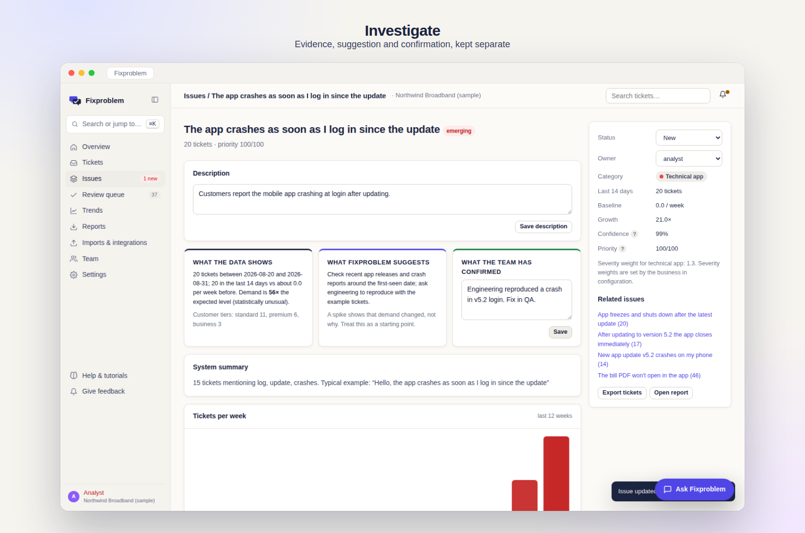
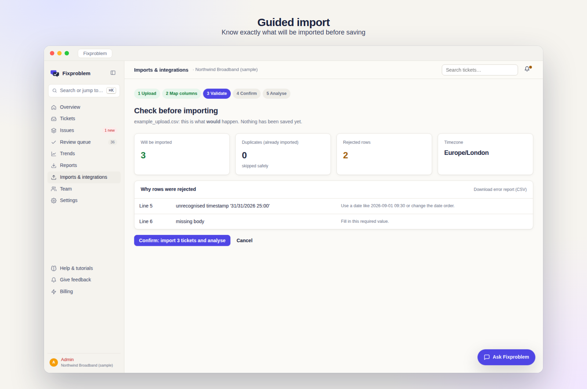
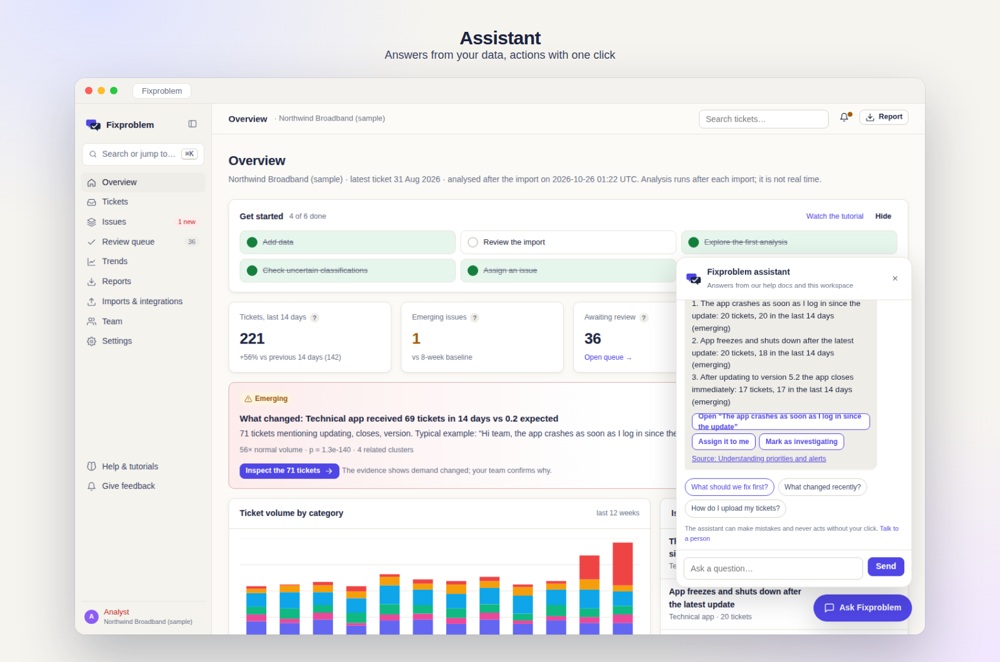
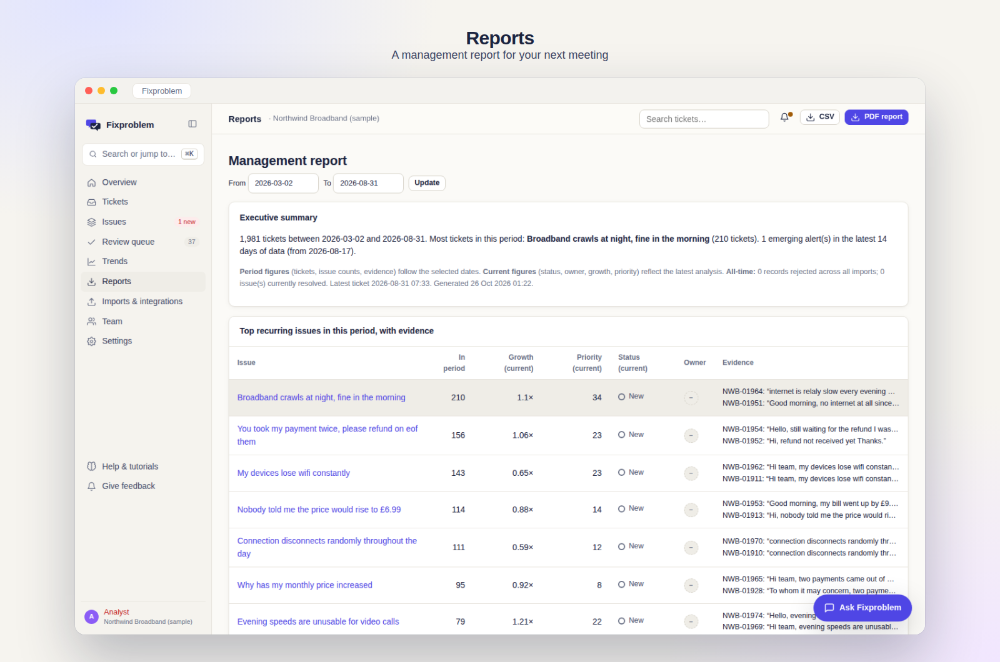

<p align="center"></p>

# Fixproblem: know what to fix next

**Support teams receive thousands of tickets, but recurring problems hide in them.** Fixproblem
analyses the tickets you import, groups them into recurring issues with readable titles, flags
statistically unusual changes in demand, and gives support and product teams the evidence, owners and
reports to decide what to fix first. It analyses support data; it is not a helpdesk.



## Try it

```bash
git clone https://github.com/Abdeenuuuur/fixproblem.git && cd fixproblem
```
- **Easiest:** double-click `start-mac.command` (Mac) or `start-windows.bat` (Windows). The first run
  installs everything and opens http://127.0.0.1:5001.
- **Manual:** `python -m venv .venv && source .venv/bin/activate && pip install -r requirements.txt && python scripts/seed_demo.py && python -m fixproblem.app`

Then:
- Click **Try the interactive demo** (no account; clearly labelled synthetic data).
- **Start your workspace** to get a private, empty workspace and upload `data/sample/example_upload.csv`
  (choose day/month/year) in the guided import.
- Ask the **Fixproblem assistant** (bottom right): "What should we fix first?"

| | |
|---|---|
|  |  |
|  |  |

**Video tutorials** (real recordings with on-screen steps):
[Product tour, 70 s](fixproblem/static/videos/tour.mp4) ·
[Import your tickets, 55 s](fixproblem/static/videos/import.mp4) ·
[Investigate and act, 60 s](fixproblem/static/videos/investigate.mp4).
https://github.com/user-attachments/assets/a5e9c5a5-8a8f-46ac-b9bb-fb8f4b5bf3c2


They are regenerated from the live app with `python scripts/record_tutorials.py`: Playwright drives a
real browser session while an overlay adds the animated cursor, spotlight and captions, and ffmpeg adds
the title cards.

## Technical decisions

| Decision | Why |
|---|---|
| **Database-per-workspace** (SQLite file per customer, plus a platform database for accounts and billing) | Physical tenant isolation: a forgotten filter cannot leak another customer's tickets. Membership is re-checked on every request. Maps to schema-per-tenant on PostgreSQL later. |
| **Classical ML** (TF-IDF + logistic regression, k-means) with a **starter model** | Fast, explainable and offline. New workspaces without labels start from a model trained on synthetic data; the workspace's own labels and review corrections are added as they accumulate. |
| **Poisson test with Bonferroni correction** for alerts | Separates real spikes from noise when many issues are tested at once. |
| **Stable issue identity** | Each new analysis matches groups to earlier issues by ticket overlap, so owners, status and comments follow the problem. |
| **Human in the loop** | Low-confidence tickets go to a review queue; corrections can be undone and are kept apart from evaluation data. |
| **Data / suggestion / confirmation separation** | Every issue page separates what the data shows, what the system suggests and what the team confirmed. A spike is never presented as a root cause. |
| **Grounded assistant** | Answers come from the help documentation and read-only workspace queries; actions are permission-checked buttons the user clicks. Claude, OpenAI or Gemini only rephrase, and customer-derived text is withheld unless an admin allows it. |
| **Payments verified server-side** | Stripe Checkout sessions are tied to the account and checked for amount, currency and product; webhooks are signature-verified and processed once. |
| **Security defaults** | scrypt password hashing, CSRF tokens, login lockout, secure cookies, and production startup refused with development secrets. |

## Evaluation

Measured on **synthetic** tickets by `scripts/evaluate.py` (details: [`results/RESULTS.md`](results/RESULTS.md) and the in-app Evaluation page):
category accuracy 99.3% (agents' own tags: 93.3%); a planted fault detected 5 days after it started with
no false alarms in the previous 12 weeks. Real tickets are messier, so treat these as an upper bound.

**137 automated tests** run in CI on Python 3.11 and 3.12. They cover analysis, permissions, workspace
isolation, payments and webhooks, CSRF, data rights, report periods, PDF robustness, issue identity and
the assistant.

## Limitations

- **Not sales-ready.** Missing: team invitations, email verification and password reset, recurring
  Stripe subscriptions, enforced usage limits, PostgreSQL with background jobs, and backups with a tested
  restore. See [`docs/RELEASE_NOTES.md`](docs/RELEASE_NOTES.md).
- **Starter categories** come from a fictional broadband company; other industries need their own
  category column or corrections until configurable categories exist.
- **Clustering** can split one problem into several groups when customers word it differently.

## About this project

**Fixproblem is a portfolio project by Abdennour Al Ayoubi** (BSc Computer Science, MSc Business and
Digital Transformation student at UWE Bristol).

### How it was built

I designed and directed Fixproblem and developed it with **AI pair-programming (Anthropic's Claude)**,
working iteratively: I defined what to build, reviewed and ran each version, tested it as a user, and
asked for changes when something did not meet the standard.

My contributions:
- **Product definition:** the problem, the target customer (support managers and product teams), the
  core journey (import → identify → evidence → assign → track) and a 30-section product and
  commercial specification covering positioning, brand, pricing, onboarding, isolation, billing and
  release gates.
- **Product decisions:** a private workspace per customer, sample data kept separate, prices and plans,
  an honest-claims policy (no fake testimonials, status indicators or certifications) and the
  priorities for each stage.
- **Testing and quality:** running every version locally, reporting problems found as a user (for
  example, that new accounts could see other data, which led to the workspace-isolation work) and
  checking the release-readiness list.
- **Delivery:** publishing, documentation review and the pilot plan.

AI pair-programming produced most of the code under my direction. Reviewing it taught me Flask
application structure, multi-tenant data isolation, statistical anomaly detection, test design and
accessible UI patterns. Defects found by automated tests and by an
independent code review are listed, with their fixes, in [`docs/RELEASE_NOTES.md`](docs/RELEASE_NOTES.md).

### Tools and languages, and why

| Tool | Used for | Why |
|---|---|---|
| **Python 3.11+** | All application and analysis code | Readable, with strong data and ML libraries |
| **Flask + Jinja2** | Web application and server-side pages | Small and explicit; easy to reason about permissions and routes |
| **scikit-learn** | TF-IDF, logistic regression, k-means, evaluation metrics | Fast, explainable classical ML that runs offline, without GPUs or paid APIs |
| **SciPy** | Poisson test for emerging-issue alerts | A statistically grounded way to tell a real spike from noise |
| **SQLite + FTS5** | Platform database, one database per workspace, full-text search | Zero setup for a pilot; database-per-tenant gives physical isolation |
| **HTML, CSS, vanilla JavaScript** | Interface, dark mode, command palette, assistant widget | No build step; fast, accessible and easy to audit |
| **SVG** | Logo, icons and charts | Sharp at any size, themeable, and charts come with text alternatives |
| **ReportLab** | PDF management reports | Generates proper PDFs on the server |
| **Werkzeug security** | scrypt password hashing | Passwords are never stored in readable form |
| **Optional LLM APIs** (Anthropic, OpenAI, Gemini) | Rewording assistant answers | Pluggable; the app keeps working without them |
| **unittest / pytest** | 137 automated tests | Business rules, permissions, isolation, payments and failure handling |
| **Playwright, ffmpeg** | Recorded tutorial videos (animated cursor, spotlight, captions, title cards) and framed screenshots | Documentation regenerated from the real app, never mocked |
| **GitHub Actions** | Continuous integration on Python 3.11 and 3.12 | Every push is tested |
| **VS Code, macOS Terminal** | Development environment | Editing, running and testing locally |

### Inspiration and references (design ideas only; no code copied)

- **Linear:** issue board, keyboard shortcuts and the ⌘K command palette.
- **Notion:** calm, minimal layout and typography.
- **Stripe:** clear pricing pages and plain-language billing terms.
- **GOV.UK Design System:** plain language, helpful error messages, accessible forms.
- **W3C WCAG 2.2:** focus visibility, contrast, reduced motion, text alternatives for charts.
- **Flask, scikit-learn, SciPy and SQLite FTS5 documentation:** framework and algorithm usage.
- **ICO UK GDPR guidance:** data rights (export and erasure), consent and retention wording.

## Licence

[MIT](LICENSE)
